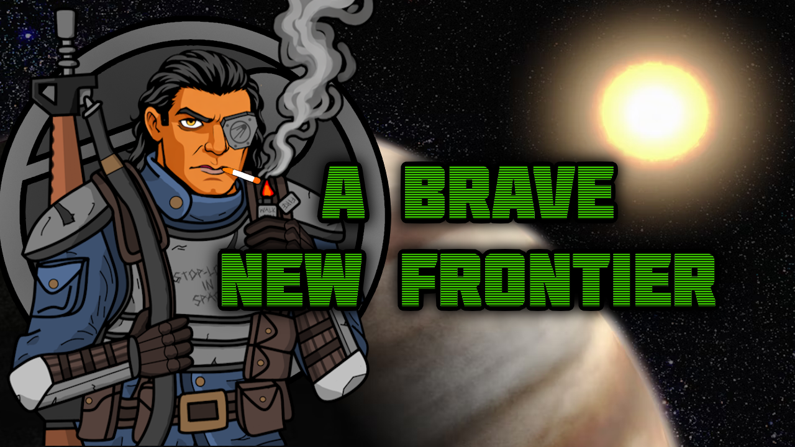

 

 
 
 

 
 

 

 
 
 
 
 
 
 
 
 
 
 
 
 
 

 
 
 
 
 
 
 
 
 
 

 
 
 
 
 
 
 
 
 
 
 
 
 
 

 

<b>Where is the CE Patch?</b> Included, kinda rough but I am not a CE user.

<b>Besides CE, can you make a patch for x,y, or z?</b> Post it in the suggestion thread! I am more than happy to make a patch if an error occurs between mods or you think that it would benefit from having patch.

<b>I have a variant idea! Where can I put it?</b> Post it in the suggestions thread. Otherwise I don't get notifications for it and it will fall in the cracks and be gone forever.

<b>I don't like x,y, or z, fix it!</b> Learn how to make a patch and change it yourself.

 

<b>Karbonpanzer</b>: Coder/Artist/Editor

<b>Krazy4Games</b>: Original Artist

(LGPL) (CC BY-NC-SA 4.0)

