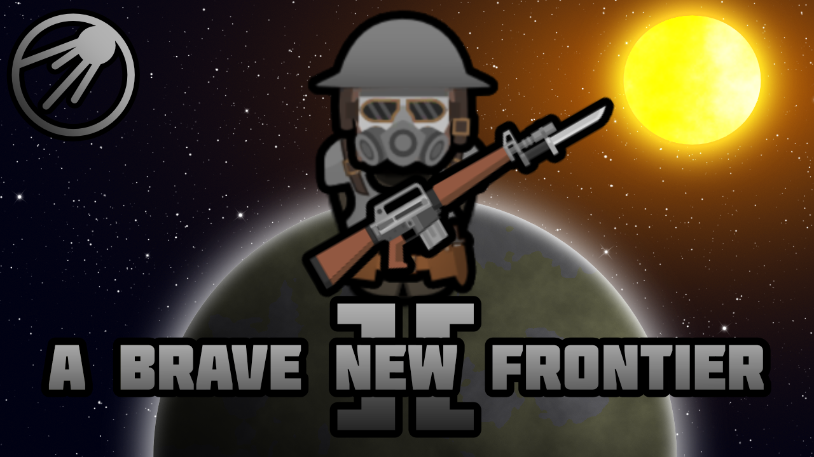

# A Brave New Frontier II

A Brave New Frontier II is a full rebuild of A Brave New Frontier. It adds two local industrial factions, a starting scenario, a new tier of flak armor, combat accessories and a line of cost-effective weapons, all built around a frontier army look.

- **Homesteaders** - A faction of long time inhabitants of this world.
- **Desperadoes** - A heavily armed faction made up of renegades, exiles, and other undesireables.

- **Settlers** - After finding a place of strategic importance, your group chose to embark to set the claim for this land. With the backing of the government, you will hold this land as a settlement and administer to it as you see fit.

**Research** (in the vanilla research tab):
- Improved Flak Armor (prereq: Flak Armor)
- Scout, Heavy and Officer Flak Armor, Modified Flak Helmets (prereq: Improved Flak Armor)
- Frontier Uniforms (prereq: Complex Clothing), then Officer Uniforms
- Infantry Kit (prereq: Complex Clothing), then Shocktrooper, Scout and Support Kits
- Streamlined Production (prereq: Precision Rifling), then Specialized Accelerant, then Power Weapons

- **Flak Armor** - A full set of armor plates, covering most of the body. Using a mixture of plasteel weave and metals, it provides good protection against gunshots and stabbing attacks.
- **Flak Helmet** - A combat helmet, reinforced with plasteel weave, providing greater protection than simple flak helmets.
- **Insulated, Shielded and Gasmask Variants** - Every flak helmet comes in three variants. Insulated: Fitted with an insulated hood which keeps the wearer's head warm. Shielded: Fitted with an improvised faceshield to protect the wearer during close quarters combat but makes them slower to respond. Gasmask: Fitted with a gasmask which protects the wearer against most gases.
- **Medic and Engineer Flak** - Medic versions are marked with a cross, to show the wearer is a medic. Engineer versions are marked with a cog, to show the wearer is an engineer.
- **Scout Flak Armor** - A stripped set of armor plates, covering their torso. The shoulders and therefore their protection have been removed to make the armor lighter for scouts.
- **Heavy Flak Armor** - A reinforced full set of armor plates, covering the body but heavier than normal flak armor. Additional layers of plasteel weave and metal offer improved protection but the additional weight slows the wearer.
- **Heavy Flak Helmet** - A reinforced combat helmet, using a different design which provides greater protection than simple flak helmets. However the additional armor slows the wearer.
- **Officer Flak Armor** - A full set of armor plates, covering most of the body. Using a mixture of plasteel weave, metals and gold, it provides good protection against gunshots and stabbing attacks while projecting their Officer status.
- **Officer Flak Helmet** - A combat helmet, reinforced with plasteel weave and gold. It provides minor boosts to psycasters but is preferred by Officers in the field.
- **Flak Boots** - A pair of boots with plasteel weave and metal protecting the feet and legs. Awkward to work in, they provide good protection to the wearer.
- **Flak Gloves** - A pair of gloves with plasteel weave and metal protecting the hands and fingers. Awkward to work in, they provide good protection to the wearer.
- **Frontier Uniform** - A full body uniform made out of thick fabric or leather. Providing minor protection and offering moderate protection against moderate weather.
- **Hot Frontier Uniform** - A full body uniform made out of thick fabric or leather. Providing minor protection and offering moderate protection against warm weather.
- **Insulated Frontier Uniform** - A full body uniform made out of thick fabric or leather. Providing minor protection and offering moderate protection against cold weather.
- **Field Hat** - A type of soft cap made out of thick fabric or leather offering moderate protection against moderate weather.
- **Hot Field Hat** - A type of soft cap featuring a neck cape, made out of thick fabric or leather offering moderate protection against warm weather.
- **Insulated Field Hat** - A fur lined soft cap fitted with an insulated hood, made out of thick fabric or leather offering moderate protection against cold weather.
- **Frontier Officer Uniform** - A full body uniform made out of the finest fabric or leather. Providing minor protection, general protection in most weather, and maintains image of an Officer
- **Officer Cap** - A flat topped soft cap worn by officers, made out of the finest thick fabric or leather. Provides general protection in most weather and image of a Officer.
- **Insulated Officer Cap** - A flat topped soft cap worn by officers, made out of the finest thick fabric or leather. Provides general protection in most weather and image of a Officer.
- **Heavy Infantry Webbing** - A heavy webbing system for keeping large amounts of spare munitions close at hand, greatly reducing their ranged weapons cool down but weighing more. It doesn't cover the body, so it can be worn happily by nudists and yttakin.
- **Scout Webbing** - A heavy webbing system for allowing greater manuevability, greatly increasing the foraging and stelath of the wearer but weighing more. It doesn't cover the body, so it can be worn happily by nudists and yttakin.
- **Shocktrooper Webbing** - A heavy webbing system for keeping large amounts of explosives and combat drugs close at hand, greatly increasing their combat skills but weighing more. It doesn't cover the body, so it can be worn happily by nudists and yttakin.
- **Infantry Belt** - A belt system for keeping spare munitions close at hand, reducing their ranged weapons cool down. It doesn't cover the body, so it can be worn happily by nudists and yttakin.
- **Engineer Belt** - A belt system for keeping spare tools close at hand, reducing their repair time in the field. It doesn't cover the body, so it can be worn happily by nudists and yttakin.
- **Medic Belt** - A belt system for keeping spare medical supplies close at hand, improving their tending quality and speed. It doesn't cover the body, so it can be worn happily by nudists and yttakin.

- **Service Pistol** - A mass-produced self-loading pistol. It is cheap and quick to fire, but lacks range and accuracy.
- **Assault Pistol** - A self-loading pistol chambered for accelerant-charged rounds. It hits harder than most sidearms, but its accuracy suffers for it.
- **Assault Revolver** - A heavy double-action revolver chambered for accelerant-charged rounds. It hits hard for a pistol, but it is short-ranged and inaccurate.
- **Assault SMG** - A compact, fully automatic personal defense weapon. Its rapid bursts are deadly up close, but its accuracy falls off quickly with distance.
- **Service Rifle** - A mass-produced gas-operated rifle with a fast semi-automatic action. It lacks accuracy, but it can put a high volume of fire downrange.
- **Service Rifle (bayonet)** - A service rifle modified for burst fire and fitted with a heavy bayonet. It fires more slowly than the standard pattern, but the blade makes it dangerous in melee.
- **Assault LMG** - A gas-operated light machine gun firing accelerant-charged rounds. It is heavy and inaccurate, but its long armor-piercing bursts can shred groups of enemies.
- **Trench Shotgun** - A single-barreled shotgun with a fast-cycling action. It fires one heavy blast of pellets at a time, but in rapid succession, making it devastating at close range.
- **Marksman Rifle** - A long-barreled precision rifle. It is slow to aim and awkward up close, but it hits hard and accurately at long range.
- **Anti-materiel Rifle** - A bolt-action heavy caliber rifle designed for armor and building penetration. Boasting incredible range and power, it is a slow and heavy weapon which requires a long time to fire accurately.
- **Trench Knife** - A short fighting knife with a reinforced knuckle guard. It is quick and easy to wield in tight spaces.
- **Machete** - A broad bladed tool used in agriculture. Often used by militarys for brush clearing and even as a weapon.
- **Power Maul** - A heavy maul with a powered striking head. Slow to swing, but each blow lands with crushing force.
- **Power Glaive** - A long polearm whose blade discharges an electromagnetic pulse on contact. It cuts deep and stuns mechanoids, but it is slow to swing.
- **Chainsword** - A sword lined with a motorized chain of cutting teeth. It tears through flesh and light armor, leaving ragged, bleeding wounds.

## Mod Compatibility

No other mods are required. Royalty and Ideology add bonus stats to officer gear when active, and Odyssey adds a unique service rifle.

## Combat Extended

A Brave New Frontier II has built-in Combat Extended support, no separate patch needed.

| Weapon | Ammo | Role |
|---|---|---|
| Service Pistol | 10mm Auto (15) | Standard sidearm |
| Assault Pistol | .50 AE (7) | Heavy sidearm |
| Assault Revolver | .45-70 Govt (5) | Elite sidearm |
| Assault SMG | 10mm Auto (30) | Close-quarters automatic |
| Service Rifle | 7.62x39mm (30) | Infantry rifle |
| Assault LMG | 7.62x51mm (100) | Squad support |
| Trench Shotgun | 12 Gauge (6) | Breacher |
| Marksman Rifle | 7.62x51mm (10) | Designated marksman |
| Anti-Materiel Rifle | .50 BMG (5) | Anti-materiel |

**Can you make a patch for another mod?**  
Post it in the suggestions thread. I'm happy to patch conflicts or mods that would benefit from it.

**I have a variant idea!**  
Post it in the suggestions thread, otherwise I don't get notified and it gets lost.

**I don't like something, fix it!**  
Learn how to make a patch and change it yourself.

**Karbonpanzer** - Coder, artist and editor  
**Krazy4Games** - Original artist  
**Shazbot** - Inspiration, through Shazbot's Frontier Uniforms  

[GitHub repository](https://github.com/karbonpanzer/A-Brave-New-Frontier-II)

Code licensed under LGPL. Art licensed under CC BY-NC-SA 4.0.